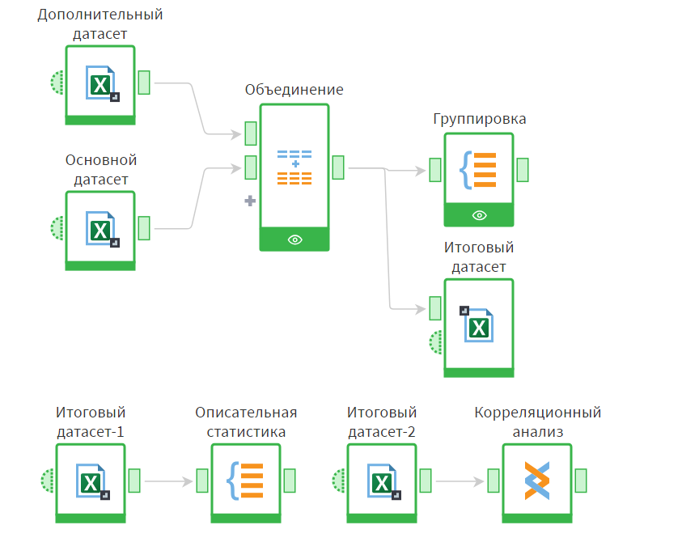
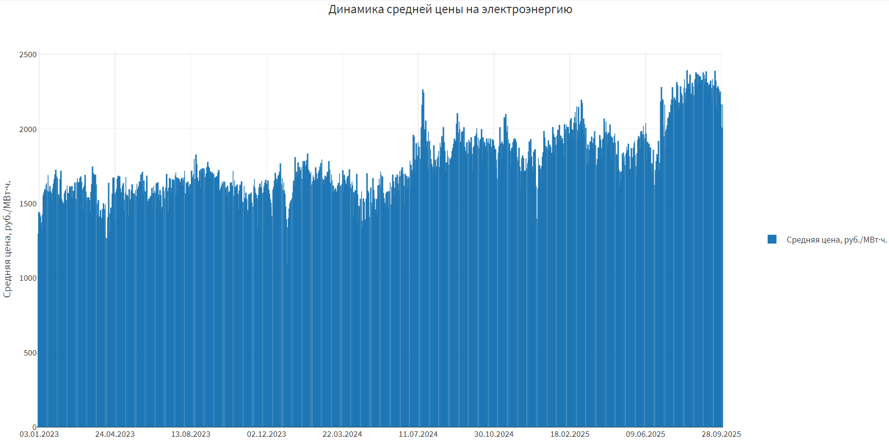
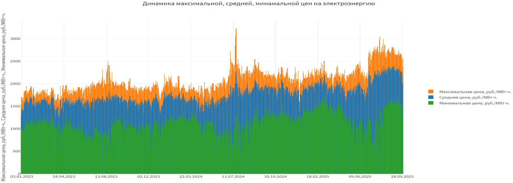

# Анализ цен на электроэнергию в России (Loginom)

Обработка и анализ суточных цен на оптовом рынке электроэнергии РФ (первая ценовая зона) за период с января 2023 по сентябрь 2025 года. Весь сценарий собран в аналитической платформе Loginom.

## Данные

- Источник: [АО «АТС»](https://www.atsenergo.ru/results/rsv/index), результаты торгов РСВ
- Период: 01.01.2023 – 30.09.2025, суточная гранулярность
- Поля: дата, объём потребления (МВт·ч), средняя / максимальная / минимальная цена (руб./МВт·ч)

## Что сделано

1. **Импорт** данных из Excel в Loginom
2. **Предобработка**: поиск дубликатов и противоречий, заполнение пропусков
3. **Интеграция**: объединение основного набора (2024–2025) с дополнительным (2023)
4. **Агрегирование**: суммарные и средние значения цен
5. **Описательная статистика**: минимум, максимум, среднее, медиана, мода, стандартное отклонение
6. **Корреляционный анализ** (коэффициент Пирсона)
7. **Визуализация** динамики цен

## Схема сценария в Loginom



## Динамика цен





## Основные выводы

- Цены на электроэнергию постепенно растут, сильнее всего к осени 2025 года.
- Разрыв между максимальной и минимальной ценой в течение суток увеличивается, рынок становится менее стабильным.
- В июле 2024 года зафиксирован резкий скачок максимальной цены, вероятно связанный с жарой и ростом нагрузки от кондиционеров.
- Средняя цена сильно коррелирует с максимальной (r = 0.94) и слабее с минимальной (r = 0.55): пиковые цены сильнее влияют на средний уровень.

| Показатель, руб./МВт·ч | Среднее | Медиана | Ст. откл. |
|---|---|---|---|
| Средняя цена | 1 761.66 | 1 707.85 | 226.39 |
| Максимальная цена | 2 082.23 | 2 020.10 | 280.93 |
| Минимальная цена | 1 129.60 | 1 138.84 | 240.37 |

## Ограничения

- Короткий период наблюдений (менее трёх лет)
- Только первая ценовая зона
- Внешние факторы (погода, топливо, регулирование) не учитывались

## Структура репозитория

```
├── README.md
├── report.pdf      # полный отчёт с описанием сценария и результатами
└── images/         # графики и схема сценария
```

## Инструменты

Loginom, Excel
